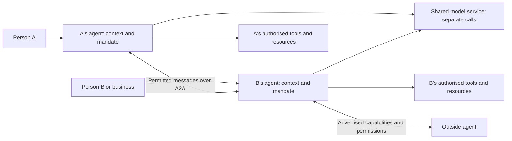

# Collab — everyone’s agent for getting things done together

Product vision and ideation document · 15 October 2026

Engineering translation: [Technical PRD](TECHNICAL-PRD.md). Dated source and deployment evidence: [Current application state](CURRENT-STATE.md).

This document captures the full product ambition. It guides product decisions across consumers, businesses, independent workers and communities. The [web PRD](PRD.md) describes an implementation of part of this vision; the hackathon retail journey is one demonstration. Features described below are proposed unless identified as present in the implementation snapshot.

## 1. What we are building

**Collab gives every person and business an agent that understands their needs, represents their interests, shares only what they permit, and coordinates with others to get things done.**

A person states an outcome, provides relevant context, and sets boundaries. Their agent finds suitable people or businesses, asks and answers questions, compares options, negotiates where appropriate, arranges resources, and follows through. Other people’s agents do the same for their owners. People intervene when their knowledge, judgment or permission is required.

The purpose is economic agency: help people buy, sell, earn, hire, learn, lend, rent, organise and collaborate without repeatedly explaining themselves or spending their day coordinating. A shop, a household, a freelancer and a home business should all have access to capable representation.

Collab should support online relationships, nearby physical interactions and combinations of both. A shop QR, an online profile, an invitation, a search result and an outside agent are entry points into the same collaboration system.

The ambition includes women entrepreneurs and workers, informal and independent providers, small shops, people with limited time or digital confidence, and established businesses. These groups need research with real users; we must not assume their constraints or preferences are identical.

## 2. Why build it

People repeatedly face the same coordination problems: finding someone suitable, checking whether an offering is current, explaining requirements, comparing incomplete quotes, negotiating, matching schedules, following up, and resolving changes. Providers spend time answering repetitive questions and pursuing requests that do not fit. Smaller participants may lack staff or software to handle this work.

Our product hypothesis is that reusable personal context, explicit delegation and agents that can communicate with counterparties will reduce that work and increase successful collaboration. This is a hypothesis to validate, not a measured market claim.

The desired outcome is more control over one’s time, information, spending and earning opportunities. Savings and income matter, but so do fewer interruptions, clearer commitments, reliable fulfilment and the ability to refuse unsuitable work.

## 3. Three starting participants, many interchangeable roles

| Participant | What they should be able to do | What their agent represents |
|---|---|---|
| Individual or household | Buy from a person or shop; hire help; find information; arrange an appointment; rent or borrow; coordinate a shared goal | Needs, preferences, budget, schedule, accessibility requirements and disclosure choices |
| Shop or business | Publish offerings; answer enquiries; quote; reserve stock; sell locally or remotely; fulfil orders; source supplies; coordinate staff and partners | Catalogue, stock, capacity, pricing rules, operating hours, fulfilment terms and staff authority |
| Individual provider or gig worker | Offer skills or time; qualify requests; quote and negotiate; book work; deliver milestones; receive payment; build a portable track record | Skills, scope, availability, service area, rates, boundaries and evidence of completed work |

These are roles, not permanent account categories. The same person can buy groceries, sell a used item, teach a class and coordinate a community event. A shop is also a buyer when restocking and a requester when hiring a repair service. Organisations need shared identities with named staff permissions, rather than sharing one person’s login.

## 4. A common collaboration lifecycle

The reusable flow is: **express an outcome → clarify only what is necessary → discover → qualify → propose → authorise → reserve and commit → fulfil → verify → follow up.**

Not every request needs every stage. An authorised factual answer can finish immediately. A fixed-price order does not need negotiation. A volunteer collaboration may have no payment. A repair might require inspection before a final quote. The workflow should adapt to the task.

The agent should first use current, permitted context. It should ask a person only for missing information that changes the next decision. When possible, it should gather independent requirements together, give a recommendation and offer a small set of actionable choices.

One goal may contain several tasks with dependencies. For example, organising an event can involve a venue, equipment, people and transport. The agent needs an overall spending limit and schedule, not merely permission to pursue each task independently. It must explain when partial success leaves the overall goal infeasible.

## 5. Breadth of use cases

This is a coverage map, not a claim that every domain is implemented. Each row uses the common lifecycle and adds domain rules.

| Interaction family | Representative goals | Additional requirements |
|---|---|---|
| Retail and everyday purchases | Find a product, compare variants, buy from a shop or individual, arrange collection or delivery | Stock, variants, reservation, payment status, substitutions, returns |
| Resale and circular use | Sell used goods, trade, donate, repair or refurbish an item | Condition, ownership claims, inspection, safe handover, acceptance criteria |
| Local services and gig work | Repair a device, clean a space, hire a photographer, find delivery help | Scope, travel time, tools, availability, quotation, cancellation and no-show handling |
| Remote professional work | Translation, design, bookkeeping, development, research assistance | Deliverables, milestones, confidentiality, revision limits, file access and acceptance |
| Learning and coaching | Find a tutor, join a class, book instruction | Qualifications, recurring capacity, learning goals and appropriate safeguarding |
| Home businesses and made-to-order work | Order food, tailoring, crafts or customised goods | Ingredients/materials, lead time, production capacity, specification approval and local requirements |
| Rentals and shared resources | Rent equipment or space; borrow tools; share facilities | Time-bounded reservations, deposits, condition records, return and damage handling |
| Mobility and logistics | Arrange transport, pickup, delivery, freight or moving | Routes, capacity, time windows, tracking, proof of delivery and relevant operating requirements |
| Business sourcing | Restock a shop, request wholesale quotes, commission manufacturing | Units, minimum quantities, lead times, purchase orders, taxes, credit terms and reconciliation |
| Work and staffing | Find a shift, engage a contractor, assemble a temporary team | Eligibility, skills, hours, pay terms, worker consent and jurisdiction-specific obligations |
| Property and spaces | Arrange a viewing, seek accommodation, book workspace | Availability, access, documents, deposits and domain-specific contracting |
| Community and non-commercial collaboration | Find volunteers, exchange knowledge, organise an activity, share resources | Membership, contribution commitments, access rules and group consent |
| Recurring goals | Repeat supplies, maintenance, lessons or service visits | Renewal rules, spending caps, changing circumstances, pause and cancellation |
| Multi-party projects | Coordinate an event, renovation, move or group purchase | Dependencies, shared budgets, quorum or individual approvals, partial failure recovery |
| Specialist and regulated services | Coordinate access to qualified professionals or institutions | Verified authority, domain-specific workflows and limits on autonomous decisions |

We can design a common system that accommodates these families. We cannot honestly promise universal execution without domain work: financial services, healthcare, legal commitments, hazardous work and services involving minors require specialised permissions and controls. A domain becomes supported when its information, execution and failure paths are defined and tested—not when a model can discuss it.

To add a new domain, define: what is offered; what makes two options comparable; required qualifications; the scarce resource; how availability is verified; permitted negotiation dimensions; authority to commit; proof of completion; and cancellation or dispute handling. Reuse the common system around those definitions.

## 6. Minimum human effort, meaningful human control

Autonomy is permission to perform particular actions under particular conditions. It is not a blanket instruction to do anything that seems useful.

| Delegation level | Agent may do | Person is asked when |
|---|---|---|
| Assist | Research, organise information and prepare proposals | An external message or action needs approval |
| Coordinate | Contact approved counterparties, ask questions and compare offers | A commitment, new disclosure or boundary change is needed |
| Negotiate | Negotiate approved terms within limits | No acceptable option exists or final approval was retained |
| Execute | Make specified bookings or purchases and fulfil permitted steps | A material exception falls outside the mandate |
| Maintain | Repeat an approved goal for a stated period or budget | Renewal, cumulative limits or changed circumstances require a decision |

A mandate should specify the goal, allowed actions, recipients or provider criteria, total budget and recurring caps, quantity, quality, timing, location, permitted substitutions, disclosure scope, expiry, cancellation conditions and escalation preferences. Financial authority, messaging authority, data access and authority to delegate onward must be separate.

The agent proceeds automatically when the next action is authorised, the facts are sufficiently current and the workflow can execute it reliably. It pauses the affected action when permission is missing, evidence conflicts, a protected limit would be crossed, or an irreversible commitment differs materially from what was authorised. Independent tasks may continue if they remain useful and permitted.

Silence is not approval. On timeout, the agent follows the agreed fallback: wait, release a hold, stop, choose a previously authorised alternative or notify the person. It cannot silently expand its authority.

### Prompt and proactive requests for input

Every intervention should show what changed, why the person is needed, the recommended choice, alternatives, the decision deadline, and what happens if they do nothing. Approval must bind to the exact proposal version; a changed price or scope invalidates the old approval.

The system should detect upcoming blockers: expiring reservations, uncertain stock, missing specifications, an approaching appointment conflict or a provider who has not responded. It can warn before a goal becomes impossible, based on observable signals rather than invented certainty.

Use in-app status and consented push delivery, with configured urgency, quiet hours, deduplication and acknowledgement. Offer other notification channels only when the person enables them. Separate urgent blockers from progress updates and daily summaries. Record whether a message was delivered and whether the person acted; never assume that sending a notification means it was seen.

The objective is fewer *unnecessary* interventions with high completion quality. A system that never asks but makes incorrect commitments is failing.

## 7. Context stays under the owner’s control

The agent should remember preferences, prior decisions, needs, offerings and relevant history so the owner does not start again each time. Information requires a source, owner, access policy, timestamp, expiry where applicable and correction path. Inferred preferences must be distinguishable from facts the owner confirmed.

Sharing should be audience-, purpose-, action- and time-specific. For example, a provider can share available slots without sharing calendar event titles; a consumer can reveal a delivery area before revealing an exact address; a worker can demonstrate a qualification without exposing unrelated documents. A shared answer may be narrower than the underlying record.

Private context can help an owner’s agent decide what is suitable without being sent to another party. The outgoing boundary must independently check what may be disclosed. A model’s instruction to keep a secret is insufficient by itself. Owners should be able to inspect what was shared, correct memory, export it, revoke future access and pause their agent. Revocation cannot erase information a recipient already received.

**Storage and disclosure are different promises.** The current web implementation stores Private facts and limits in the owner’s account on the server, with policy preventing disclosure to counterparties. Its local-note inference path can fall back to cloud inference. Therefore “under your control” must not be presented as “never leaves your device.” The target product should offer explicit processing choices: device-only, owner-approved cloud processing, and permitted shared context. Device-only must never silently fall back to cloud.

For teams and shops, access must respect staff roles and employment changes. A clerk may check stock and hand over an order without accessing supplier credit terms, owner notes or every customer’s history.

## 8. Inventory, availability and other resources

Inventory is a specific instance of a broader resource problem. Goods have quantities; people have time and workload capacity; equipment and rooms have reservable intervals; made-to-order products consume materials and production capacity. The common actions are check, quote, hold, commit, release, fulfil and reconcile.

### Retail inventory strategy

Support retailers at three levels of operational maturity:

1. **No stock system:** publish offerings with availability marked unknown or last confirmed. The agent asks the shop only when necessary and never claims a guaranteed item from an old listing.
2. **Collab-managed stock:** maintain products, variants, units, locations, on-hand quantities, reservations, adjustments and order fulfilment. Provide simple manual updates, batch import and assisted entry with confirmation.
3. **Connected inventory:** integrate a POS, commerce platform or ERP. The shop chooses the source of truth. Use supported change events and reconciliation rather than maintaining an unrelated competing count.

For tracked stock, available-to-promise is derived from sellable on-hand stock minus active reservations and a configured safety buffer. Do not subtract committed orders twice if the inventory source already represents them as reservations. Damaged, expired or quarantined stock is unavailable; expected replenishment is not immediately sellable stock.

Check the exact variant, quantity, location and record version before promising it. Reserve atomically with an expiry, commit the reservation on the defined order transition, and release it on cancellation, failure or expiry. A quote is not a reservation. The retailer should see whether an item is merely offered, held, sold, handed over or returned.

An online agent cannot prevent an unrecorded walk-in sale. When the source of truth is stale or disconnected, reduce certainty, use a safety buffer, or request confirmation. Show the timestamp and confirmation status instead of presenting an estimate as live stock.

If stock disappears, the agent may search for another variant, shop, fulfilment location or replenishment window within the owner’s substitution rules. Otherwise it asks with a concise choice. Never silently replace an agreed product or collect payment for an unavailable item without the buyer’s authorised terms.

Returns need a separate decision about refunds and whether the item can re-enter sellable stock. Refund status and stock status are related but distinct.

### People, calendars and capacity

A calendar connector is one source of availability. Working hours, travel buffers, existing jobs, workload, equipment and qualifications may also constrain what someone can accept. An empty calendar interval does not by itself mean a worker agreed to work then.

The agent combines the permitted sources, offers suitable slots, places an expiring hold, and confirms once the required parties agree. Booking needs time zones, recurrence, rescheduling, cancellation and collision checks. A provider may share “available Tuesday afternoon” while keeping the underlying calendar private.

For remote work, capacity may mean hours per week or milestone throughput rather than a specific appointment. For a home food business, it may mean meals per day plus ingredient availability. The same resource interface supports different domain rules.

## 9. Integrations as a general capability system

Connectors should expose specific capabilities rather than provide unrestricted account access. A capability declares its owner, permitted readers and actions, source freshness, required inputs, approval conditions, idempotency behaviour and how to reverse or compensate for an action.

| Capability | Possible sources | Typical permitted result |
|---|---|---|
| Availability | Calendars, rostering, working hours, task commitments | Suitable slots or capacity, without unrelated event details |
| Supply | POS, stock ledger, catalogue, supplier feed | Current offer, availability and a reservation |
| Skills and eligibility | Owner profile, credential issuer, portfolio | Relevant evidence or a verified attribute |
| Location and fulfilment | Owner preferences, maps, delivery systems | Service area, route estimate or authorised delivery information |
| Documents and knowledge | Notes, files, business policies, order records | A purpose-limited answer, excerpt or approved document |
| Financial execution | Payment provider, invoicing, accounting | Authorised charge, invoice, payment status or refund record |
| Communication | Agent endpoint, permitted messaging channel, notification provider | A scoped request, status update or decision request |

Read access does not imply write access. Knowing a free slot is different from booking it; seeing a balance is different from spending it. Credentials must be scoped and revocable. Losing a connector should put affected tasks into a recoverable state and tell the owner what needs reconnecting.

## 10. Models, agents and why A2A is useful

### Four concepts that should not be confused

- **Model:** the engine that interprets language or proposes an answer.
- **Inference:** one execution of that model on supplied input.
- **Agent:** an identity with an owner, context, permissions, tools, task state and an execution loop; it may call a model when useful.
- **Protocol:** the agreed format and lifecycle for communicating across agents or systems.

Two agents can call the same model through the same inference service. They do not need separate model weights, dedicated model servers or different vendors. What must remain separate is their identity, authorised context, credentials, decisions and commitments. Ordinary inference calls do not give the second caller the first caller’s prompt; accidental sharing arises from application state, retrieval, logs, tool access or deliberately merged conversations and must be prevented there.

### Architectural alternatives

| Approach | Benefits | Costs or limitations | Fit for Collab |
|---|---|---|---|
| One shared assistant sees both sides’ context | Simple orchestration; can optimise a jointly agreed objective; may require fewer calls | Both parties must consent to a common mediator; conflicting interests need an explicit policy; all supplied private information is available within that shared context | Useful optional mode for jointly owned tasks or explicit mediation |
| Separate owner agents using the same model | Shared operational stack; consistent capabilities; each owner retains a distinct mandate and context boundary | Multiple decisions can mean more calls; orchestration and isolation still need engineering; shared model/provider failures can affect both | Recommended baseline |
| Separate owner agents using different models/providers | Can match different devices or tasks; supports outside providers; may diversify some failures | More evaluation, cost routing, inconsistent capabilities and failure handling; different models do not themselves guarantee privacy or fairness | Supported choice when useful, not a requirement |

One model can simulate both parties in a single prompt, but that simulation alone is not separate representation. A deterministic service could also match both parties’ constraints if both explicitly authorise a trusted mediator. We should choose that mode for aligned goals and retain separate representation where people want their own boundaries and interests respected.

Two agents should exchange purposeful proposals and evidence, not talk indefinitely. Fixed terms, factual lookups, permission checks, arithmetic, reservations and state transitions should use ordinary code where possible. Stop when there is agreement, a clear incompatibility, a missing permission, a deadline or a round/cost limit. Measure actual calls and completion cost rather than assuming two agents always double the cost.

### Device and cloud inference are another choice

A small model on the device can reduce network dependence and keep the input for that inference local. It also depends on device support, available memory, model download and sufficient capability. A cloud model offers shared capacity and an agent that can run while the person’s phone is unavailable, but requires connectivity and sends approved input to the service.

It is technically possible to deploy a suitably licensed, portable model on both a device and a server when hardware permits. This reduces model-family variation, but it does not eliminate separate runtimes, synchronisation, access control or quality evaluation. Collab’s current Nano and cloud Gemini paths use different offerings; a cloud endpoint’s model cannot simply be assumed to run inside the browser. Firebase documents explicit on-device/cloud inference choices in its [hybrid inference guidance](https://firebase.google.com/docs/ai-logic/hybrid/web/configuration-options).

The product should be model-independent: a cloud-only deployment can serve both owners’ agents; a local path is an optional capability with explicit privacy semantics. Each owner’s device and always-on service are two execution surfaces of their agent, not two competing representatives.

### Why use A2A

The [A2A specification](https://a2a-protocol.org/latest/specification/) defines discovery through agent cards, message/task exchange, status and result handling, and optional asynchronous update mechanisms. This gives independently implemented agents a common way to interact. Collab can expose selected capabilities to outside agents without sharing its model, prompts or private memory.

A2A does not require different models. If every participant lived inside one application, internal APIs could implement the same collaboration flow with less protocol overhead. A2A is valuable because the product vision includes people represented by other companies’ agents, different runtimes and independent systems. It also adds schema/version handling, authentication, external-input validation and interoperability testing.

Publishing a card does not make an agent automatically visible to every other agent. Discovery needs a directory, known URL, link, QR, invitation or integration. A caller must understand the exposed capability, satisfy authentication where required and receive only the access its owner permits. Generic A2A messaging does not by itself make every custom commerce schema interoperable; capability negotiation and domain adapters remain necessary.

Open communication is not open access. Outside agents may discover public offerings; deeper context and actions require permission. Signatures can authenticate a statement under a trusted key, but do not prove that stock exists, that a human agreed, or that a payment settled.

### Recommended architecture

Use one logical agent identity per person or organisation, separate policy and state per owner, a shared model service by default, optional local or specialist inference, A2A at collaboration boundaries, and scoped connectors for tools. Keep policy enforcement, resource reservations and financial state outside model-generated text.

Separate agents on Collab still share an operator. This architecture does not imply that Collab cannot access server-held data or that the parties have independent infrastructure. Stronger storage privacy, key ownership and federation are further design choices.

## 11. Execution, trust and recovery

The product needs durable work, not only successful conversations. Tasks must survive an app closing, a server restarting, a delayed response or a disconnected integration. Persist the goal, proposal version, mandate, resource holds, next action and deadlines. Use retryable jobs and an outbox, and make side-effecting operations idempotent so retrying does not create a second booking or charge.

Track agreement, reservation, payment, fulfilment and acceptance separately. A signed agreement does not prove payment; payment does not prove delivery; handover does not resolve a later quality dispute. Each status needs evidence from the responsible source. In test mode, every affected status must clearly remain simulated.

Cross-provider workflows cannot assume a single atomic transaction. If a venue succeeds and equipment fails, the system needs a pre-authorised alternative or a clear partial-failure decision, plus cancellation or compensation for commitments already made. Do not describe partial progress as a completed goal.

| Challenge | Product response |
|---|---|
| Conflicting or outdated facts | Keep provenance and timestamps; recheck material facts before commitment; expose uncertainty |
| Overselling or double booking | Authoritative resource ledger, atomic holds, version checks, expiry and reconciliation |
| Prompt injection or excessive requests | Treat outside content as data; apply deterministic permissions, validated actions and bounded resource use |
| Impersonation or forged messages | Authenticate where needed, verify trusted keys, bind approvals to identity and proposal version |
| Manipulative negotiation or discrimination | Respect owner boundaries; prohibit fabricated offers and unauthorised disclosure; explain recommendation criteria and audit outcomes |
| Spam, harassment and unwanted contact | Audience controls, contact limits, block/report tools and protected communication channels |
| Failed notification or absent owner | Persist the decision request, apply the approved timeout path and release expiring commitments |
| Non-response or unavailable provider | Stop after an appropriate deadline, try permitted alternatives and avoid repeated unwanted contact |
| Cancellation, no-show or poor work | Explicit terms, evidence, recourse, dispute workflow and transparent status for both parties |
| Bad connector data or outage | Mark source unavailable, stop dependent commitments, retry and reconcile when restored |
| Excessive inference or action cost | Per-goal budget, call/round limits, reuse of current facts and deterministic shortcuts |
| Shared devices and account changes | Account-scoped storage, explicit local persistence choices, session controls and revocable team roles |

## 12. Inclusion and practical access

Empowerment should be observable in the product: a person can represent their skills or goods without maintaining a complex storefront; choose their language and preferred interaction style; set a floor or boundary without disclosing it; see why an offer was recommended; and leave with their permitted records.

For women, home businesses and workers, design for control over working hours, service areas, disclosure of a home address, contact permissions and the choice of counterparties. Support blocking and reporting, and avoid requiring public contact details merely to become discoverable. Validate these choices with women across different work and household situations.

Support low-bandwidth use, clear text, accessible controls, and assisted onboarding. Future voice and other channels should use the same policy and approval model. A delegated helper must have explicit, limited authority rather than using the owner’s credentials.

Do not assume every potential counterparty has an agent. Provide an invitation and a simple human response path. Clearly identify which actions came from the person, their authorised representative or their agent. An external shop found through search is a lead until it has a reachable, consenting transaction path.

## 13. Product experience and adoption

The home experience centres on goals and decisions: “what I need,” “what I offer,” “what my agent is doing,” and “what needs me.” Context and rules remain inspectable and editable. Show concise progress with access to the detailed record when needed.

Providers should be able to start with a small offering, typical questions, a service area or fulfilment method, and simple boundaries. Advanced inventory, teams and integrations can follow. Requesters should get useful progress before being asked to complete a large profile.

Adoption should begin with connected groups where both sides obtain repeat value—such as a neighbourhood network or a community of service providers—while preserving the general product architecture. A focused adoption cohort is an operating choice, not a permanent limit on who Collab serves. Early pilots should cover goods, time-based services and remote work to test whether the common design actually transfers.

Possible revenue models include provider subscriptions for workflow tools, paid team/integration capabilities and clearly disclosed fees for supported transactions. These are hypotheses. Avoid business incentives that reward unnecessary negotiation, conceal paid ranking, sell private context or systematically favour one side. Measure affordability for small providers before fixing pricing.

## 14. What success should mean

The primary outcome is **a useful goal completed correctly within the owner’s mandate, with low effort and a clear record**.

Measure completed goals by domain; fulfilment and acceptance separately from agreement; time to completion; unnecessary interventions; response-to-decision time; manual coordination time saved; provider conversion and repeat work; consumer outcomes; cancellations and disputes; stock/booking errors; unauthorised actions or disclosures; per-goal cost; and repeat usage on both sides.

Evaluate each autonomy level with realistic exceptions. Include infeasible requests where refusing or asking is correct. For privacy, test semantic, encoded and multilingual extraction in addition to exact-match canaries. For interoperability, use an independently implemented external agent and verify the complete lifecycle. Model diversity or an A2A label is not evidence of success by itself.

## 15. Implementation snapshot and evolution

Code reviewed for this document: `server/src/ai/gemini.ts`, `web/js/agent.js`, the web PRD and the existing engagement architecture. This is a source review, not a new production verification.

The current foundation includes per-person agent identities, shared Gemini inference infrastructure, context tiers and rules, requests and offerings, matching, guarded negotiation, owner decisions, A2A communication, test payment records, public receipt verification and pickup. The model layer has configurable model selection/fallback and a separate embedding path. The device-note path currently attempts local inference and can fall back to the server. This is already more nuanced than “two models talking to each other.”

The broader vision requires resource ledgers and inventory connectors, availability and booking, richer goal planning, durable execution, scoped integration grants, organisation roles, stronger processing controls, domain-specific fulfilment and recourse, and validated outside-agent workflows. The presence of a category in the reader does not mean these operational capabilities exist for it.

Build in capability increments:

1. **Representation:** clear owner context, permissions, agent identity, requests, offerings and visible decisions.
2. **Reliable collaboration:** durable tasks, fresh facts, purposeful agent exchange, timely escalation and verified results.
3. **Resource commitments:** stock and capacity, holds, bookings, cancellation and reconciliation.
4. **Connected execution:** inventory, calendars, documents, payments and fulfilment systems through scoped connectors.
5. **Composed goals:** recurring and multi-party workflows with shared constraints and partial-failure recovery.
6. **Open participation:** external agents, portable records, interoperable capabilities and domain expansion validated with real participants.

These increments refine one broad product. They do not require separate apps for shoppers, shops and workers, nor a different model for each role. Implementation priorities should follow user value and the reliability of the complete journey.

## 16. Decisions established by this vision

- Collab serves people and organisations across buying, selling, services and collaboration; retail is one important use case.
- Each owner has distinct representation and control. The same owner can take several roles.
- Agents can use one shared model service. Different models and local inference are optional engineering choices.
- A2A supports collaboration beyond Collab; discovery, trust and domain semantics still need product work.
- The system pursues outcomes with the least necessary human coordination, under explicit and revocable authority.
- Context sharing, processing location and storage are separate controls whose promises must match the implementation.
- Inventory, time, equipment and capacity share a resource lifecycle with domain-specific constraints.
- Unknown availability remains unknown until verified. An agent cannot invent consent, stock, payment or completion.
- The product is extensible across domains; each new domain must earn a supported status through a tested end-to-end workflow.

## Sources and related documents

- [A2A specification](https://a2a-protocol.org/latest/specification/) — protocol concepts and interoperability surface.
- [Firebase AI Logic documentation](https://firebase.google.com/docs/ai-logic) — official reference for the device/cloud inference integration; runtime availability must be verified against its current documentation and supported devices.
- [Current web PRD](PRD.md) — implementation requirements; narrower than this product vision.
- [Engineering handoff](HANDOFF.md) — deployment and verification status.
- [Hackathon assessment](HACKATHON-INNOVATION.md) — demonstration and submission positioning.

The product strategy, resource model, autonomy design and proposed use cases above are design recommendations. They are not claims that those features are deployed or that their market impact has already been measured.
