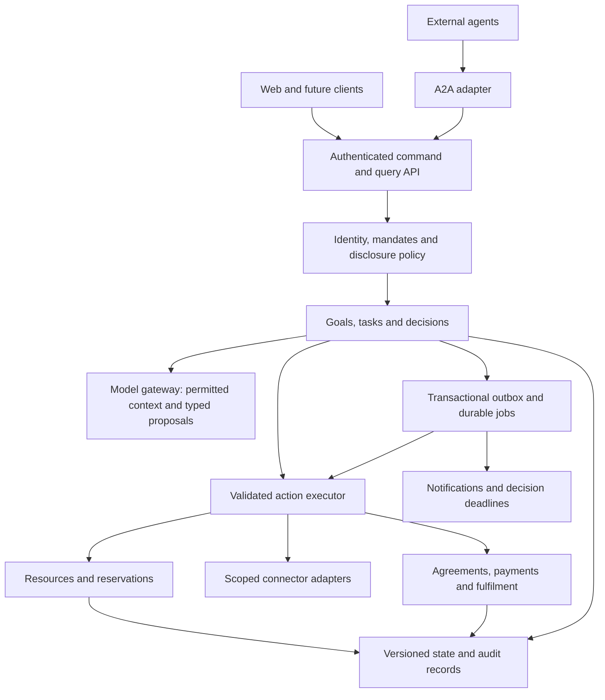

# Collab — technical product requirements

Version 1 · 15 October 2026 · Status: proposed technical target, not an implementation-completion claim.

Product authority: [PRODUCT-VISION.md](PRODUCT-VISION.md). Dated implementation evidence: [CURRENT-STATE.md](CURRENT-STATE.md). The earlier [web PRD](PRD.md) remains a historical implementation reference.

## 1. Objective and engineering position

Build one extensible collaboration system through which people and organisations express goals, delegate bounded authority, share permitted context, and coordinate discovery, agreement and execution. Consumers, shops and independent workers are roles of the same principal model. Buying, providing services and non-commercial collaboration use common primitives with domain-specific validation.

Retain the working application and incrementally evolve it. Start with a modular TypeScript service, the existing web client, Firestore and background jobs. Do not introduce separate services or a universal workflow programming language merely to appear generic. Split infrastructure only when measured scaling, ownership or isolation needs justify it.

The shared model service may power all owner agents. Identity, context, grants and execution authority remain separate. A2A connects agent boundaries; connectors expose authorised tools and resources. The model proposes typed plans and actions; deterministic application services validate and execute them.

## 2. Scope and delivery stages

| Stage | Outcome | Release gate |
|---|---|---|
| T0 — trustworthy baseline | Current conversations and simulated retail path have consistent state, claims and recovery | Existing regression suite passes; priority correctness gaps in §13 addressed; source/deployed identity visible |
| T1 — reusable collaboration core | Versioned goals, capabilities, mandates, decisions and configuration replace scattered assumptions | Goods, a service request and a no-payment information request use the core without new core category branches |
| T2 — resource commitments | Inventory quantities and time-slot capacity share check/hold/commit/release semantics | Concurrent last-item and overlapping-slot tests prove no over-allocation within the authoritative ledger |
| T3 — connected execution | Scoped connectors, order/booking fulfilment, provider-confirmed payment where enabled and recovery | Credential revocation, duplicate events, outages and partial completion have tested outcomes |
| T4 — composed goals | Multiple providers, dependencies, recurring goals and cumulative budgets | Restart and compensation tests preserve authority and explain partial failure |

Each stage should retain the consumer, business and worker paths. A stage can ship a smaller validated set of capabilities while the underlying participant and resource models remain general.

## 3. Architecture and module boundaries

| Module | Owns | Must not do |
|---|---|---|
| Identity/access | People, organisations, membership, agent identities and grants | Infer authority from a display name or model output |
| Context/policy | Facts, provenance, audience/purpose rules and processing choices | Expose all owner context to every task or connector |
| Goals/tasks | Lifecycle, dependencies, mandate binding, progress and decisions | Treat a completed conversation as proof of fulfilment |
| Capability/domain registry | Validated input/output schemas, supported actions and UI metadata | Execute arbitrary code supplied as configuration |
| Model gateway | Task-based model routing, schemas, metering and processing restrictions | Write commitments directly or bypass action validation |
| Resource service | Availability, holds, commitment, release and reconciliation | Invent stock from a listing or infer consent from a free calendar slot |
| Commerce/fulfilment | Agreements, order/booking state, payment references and completion evidence | Equate a test token or signed proposal with settled funds |
| Connectors | Scoped access to external systems and normalised results | Reuse one owner’s credentials for another owner |
| Jobs/notifications | Durable dispatch, retries, deadlines, user decisions and acknowledgements | Depend on a browser remaining open to finish accepted work |
| A2A adapter | Discovery, protocol translation, caller identity and supported capabilities | Grant access simply because a caller speaks A2A |

## 4. Data contracts

All persistent aggregates need `id`, `schemaVersion`, `revision`, creation/update timestamps and an explicit owner or access scope. Use stable IDs rather than display labels as business keys. References must be checked for owner/organisation consistency on every command.

| Entity | Required concepts |
|---|---|
| Principal | Person or organisation; membership and staff-role relationships; locale/time zone |
| AgentIdentity | Principal, trusted endpoint/key references, advertised capabilities and lifecycle status |
| ContextFact | Value, classification, source, confirmed/inferred status, observed/expiry times and disclosure policy |
| CapabilityDefinition | ID/version, action names, schemas, domain adapter, permission requirements and supported fulfilment modes |
| Offering | Owner, capability/version, attributes, pricing terms, resource references and availability source |
| Goal | Owner(s), desired outcome, constraints, budget allocation, success criteria, mandate and task references |
| Task | Goal, participants, capability/version, state/revision, deadline, inputs/results and causal event references |
| Mandate | Grantor, permitted actions/recipients/resources, budget and cumulative caps, disclosure scope, expiry/revocation |
| Proposal/Agreement | Versioned parties, line items or deliverables, terms, totals, validity and exact approval references |
| DecisionRequest | Owner, proposal/action version, reason, choices, recommendation, deadline and authorised timeout behaviour |
| Resource | Owner, resource type, capacity/unit, location or time-zone reference, authoritative source and freshness |
| Reservation | Resource, quantity or interval, holder, expiry, expected revision and state |
| PaymentAttempt | Agreement, provider/mode, amount, idempotency reference, authoritative status and evidence |
| Fulfilment/Acceptance | Agreed obligation, delivery/work evidence, recipient decision, dispute and compensation references |
| ConnectorGrant | Principal, provider, credential reference, approved scopes/actions, expiry and revocation |
| ActionExecution | Actor/mandate, target/input hash, idempotency key, status, result and compensation reference |
| OutboxEvent/AuditEvent | Causation/correlation IDs, aggregate revision, event type, minimal payload and retention class |

Money must use an explicit currency plus integer minor units where appropriate, or a validated decimal representation for priced units requiring greater precision. Do not assume every currency has two decimal places or use floating-point equality for settlement. Represent quantity with a unit and decimal precision policy. Currency conversion requires a named rate source, timestamp and owner permission; otherwise reject incompatible currencies.

Represent online/in-person/hybrid fulfilment as a typed field, not a magic location string or coordinates. Store instants consistently; retain IANA time zone and local recurrence intent for bookings. Keep unknown availability distinct from zero capacity and from confirmed availability.

## 5. Configuration and avoiding hardcoded business logic

The goal is to change supported business policy without editing the core engine. It is not to remove every constant or make security optional.

### Configuration layers

| Layer | Examples | Authority and change process |
|---|---|---|
| Deployment settings | Project/region, public endpoints, queue names, model provider credentials references | Environment-specific validated manifest; secrets in secret storage; startup validation |
| Operational policy | Quotas, retry budgets, timeouts, permitted model routes, feature availability | Versioned platform configuration, bounded values, audit and rollback |
| Domain definitions | Attributes, units, pricing modes, resource requirements, valid actions and forms | Reviewed schema documents plus registered typed adapters; compatibility tests |
| Organisation policy | Staff roles, pricing constraints, business hours, stock source and allowed integrations | Authorised administrator; cannot weaken platform security requirements |
| Owner mandate | Goal-specific spend, timing, disclosure, substitutions and allowed commitments | Owner approval; versioned and revocable; cannot exceed organisation/platform authority |
| Task snapshot | Effective non-secret policy and domain/model versions used for a task | Recorded for reproducibility; live revocation and stricter safety rules still take effect |

Resolve effective authority as the intersection of applicable grants and constraints. For ordinary settings use documented precedence: platform default, permitted organisation override, owner preference, task choice. Overrides must pass validation; no layer may grant permission forbidden by a stronger boundary. Never publish private negotiation limits in client configuration or agent cards.

Expose only safe UI policy metadata: remaining quota, reset time, supported currencies, available actions and schema versions. UI labels must derive from these responses rather than duplicating quota numbers. Limit mandatory runtime configuration to values needed by that deployment; optional integrations report unavailable instead of breaking unrelated features.

### Required extraction from the existing code

| Change | Requirement and acceptance |
|---|---|
| Currency/locale | Replace INR-only assumptions in data, parsing, display and verification together. Two fixture currencies and a no-payment request round-trip correctly; unsupported currency fails clearly. Preserve old signed payloads unchanged. |
| Checkout contents | Read item IDs, variants, quantities, units and totals from the agreed proposal. A two-line order must not collapse into a synthetic one-item checkout. |
| Offering selection | Require a selected offering/capability or resolve ambiguity explicitly. Reordering stored facts must not change the selected product. |
| Quotas and timing | Centralise price/Maps quotas, negotiation budgets, deadlines, hold TTLs and retry policy; use distinct settings for distinct semantics. UI must display the same quota/reset policy that the server enforces. |
| Model routing | Select models by task/capability/processing policy through one gateway. Domain code must not select a model by a scattered literal. Keep embeddings, grounding and generation as distinct capabilities. |
| Domain definitions | Evolve `domains.json` into validated, versioned definitions. Adding a supported-schema service category must require data/adapter registration, not a chain of category-name conditionals. |
| Deployment/demo | Separate staging/production/demo manifests. Demo seeding must be explicit and isolated; a new deployment must not silently inherit a project, demo identity or public hostname. |
| UI rendering | Render shared fields/actions from typed view models; use a registered component for specialised interactions. Do not render model-generated HTML or arbitrary schema scripts. |

Preserve code invariants: authentication, owner isolation, permission checks, signature validation, atomic reservations, nonnegative available capacity, bounded execution and exactly-once business effects through idempotency. Protocol constants and immutable version-specific payload definitions are legitimate constants. Do not convert them into casual admin settings.

Configuration is schema-validated, versioned, permissioned, reviewed and audited. Reject unknown fields where they could affect execution, unsupported adapter IDs and invalid ranges. Support rollback. Hash/pin the effective policy in task audit records. A changed configuration must never reinterpret a previously signed agreement.

## 6. Functional requirements and acceptance criteria

| ID | Requirement | Acceptance criterion |
|---|---|---|
| TP-01 | One principal can consume and provide; organisations have staff roles | The same person buys and sells; a fulfilment clerk cannot change owner mandates or access private business notes |
| TP-02 | Persist goals separately from individual conversations | A goal can link multiple tasks; an information-only goal can complete without a price, cart or seller |
| TP-03 | Versioned capability discovery and schema negotiation | An outside client selects a capability/version; an unsupported version gets a structured error and supported alternatives |
| TP-04 | Apply audience, purpose, action and expiry checks to context | A provider receives available slots without unrelated calendar details; revocation prevents the next disclosure |
| TP-05 | Bind every executed action to effective authority | Raising a proposal’s amount or changing a recipient invalidates a prior approval; timeout never creates permission |
| TP-06 | Plan through typed actions and deterministic validation | A model-proposed unknown tool, excessive amount or invalid state transition cannot execute |
| TP-07 | Generate actionable decision requests promptly | A blocker creates one persistent request with reason, recommendation, deadline and fallback; a duplicate event creates no second request |
| TP-08 | Reserve quantity/time resources atomically | Concurrent requests for the last unit or exclusive slot yield at most one commitment; expired holds release capacity |
| TP-09 | Respect source freshness and unavailable connectors | A stale listing cannot claim confirmed availability; a connector outage pauses dependent commitments and shows recovery options |
| TP-10 | Separate payment, fulfilment and acceptance | Payment success does not automatically mark delivery complete; test-mode events cannot enter production settlement metrics |
| TP-11 | Execute repeatable commands safely | The same idempotency key/input returns the original result; different input with that key conflicts; concurrent requests do not double-book or double-charge |
| TP-12 | Persist and resume work | A restart after state commit but before job submission recovers via the outbox without user refresh or duplicate side effects |
| TP-13 | Support failure and cancellation | A cancellation releases uncommitted holds; committed obligations follow their cancellation/compensation terms |
| TP-14 | Enforce local-only processing when selected | Unavailable local inference returns an actionable limitation; no cloud request contains that protected input |
| TP-15 | Make progress and authority visible | Owner can see what was shared, committed, waiting or failed and can pause future actions without erasing existing obligations |
| TP-16 | Support multi-party and recurring goals | Combined commitments never exceed the goal’s cumulative authority; partial failure yields a defined alternative or decision |

## 7. State machines and command contracts

Use separate state machines. Suggested initial vocabularies:

- Goal: `draft`, `active`, `waiting`, `completed`, `partially_completed`, `cancelled`, `failed`.
- Task: `pending`, `running`, `waiting_for_input`, `waiting_for_external`, `succeeded`, `failed`, `cancelled`.
- Reservation: `held`, `committed`, `released`, `expired`.
- Agreement: `proposed`, `partially_approved`, `accepted`, `superseded`, `cancelled`.
- Payment: `not_required`, `pending`, `authorised`, `settled`, `failed`, `refunded`, with a separate environment/mode field.
- Fulfilment: `not_started`, `in_progress`, `delivered`, `accepted`, `disputed`, `cancelled`.

An accepted agreement creates obligations; it does not complete them. State changes require an allowed transition, expected revision, valid authority and required evidence. Record causal events. Expiry workers and connector callbacks use the same command handlers as foreground actions.

Candidate API surface (proposed, not existing endpoints):

| Contract | Purpose |
|---|---|
| `GET /capabilities` | Safe supported capabilities, schemas, modes and version metadata |
| `POST /goals`, `GET /goals/:id` | Create and observe an owner-scoped goal |
| `POST /goals/:id/commands` | Submit typed actions with mandate, expected revision and idempotency key |
| `POST /decisions/:id/resolve` | Approve/refuse the exact pending version |
| `POST /resources/:id/holds` | Request a bounded hold under authority |
| `POST /reservations/:id/commands` | Commit/release; expiry is also an authorised system action |
| `POST /connector-grants`, revoke command | Establish/revoke explicit scopes |
| Connector event ingress | Verify provider authentication/signature, deduplicate and normalise changes |
| A2A adapter | Translate supported agent requests into the same application commands |

Use stable error codes such as `AUTHORITY_REQUIRED`, `VERSION_CONFLICT`, `AVAILABILITY_UNKNOWN`, `CAPACITY_UNAVAILABLE`, `CONNECTOR_UNAVAILABLE` and `UNSUPPORTED_CAPABILITY`. Localised UI text maps from these codes. Do not require another model call to understand a routine failure.

## 8. Resources, inventory and booking

Define a resource-provider interface with `describe`, `checkAvailability`, `hold`, `commit`, `release` and `reconcile`. Responses include authoritative source, observed time, resource revision, reservation ID/expiry and certainty. Provider support for atomic holds must be explicit; do not simulate a guarantee that an external system cannot make.

Implement the first two adapters against the same contract: a quantity ledger for goods and interval/capacity scheduling for people or equipment. Both need transaction tests. A calendar’s free/busy data is an input; working rules and owner permission still determine bookability.

For retailers, support manual confirmation, Collab-managed inventory and an external system of record. Manual mode produces an availability decision, not fabricated live stock. Ledger mode separates sellable stock, reservations and adjustments. Connected mode records source IDs, deduplicates events and reconciles drift. Returns re-enter sellable stock only after the required condition check.

Time resources require working hours, time zones, duration, travel/setup buffers, exceptions and cancellation rules. Recurrence needs explicit scope when changing one occurrence versus the series. Unknown or disconnected availability must remain visible.

An unavailable resource triggers only pre-authorised alternatives; material product, quality, price or time changes require a fresh decision. Resource holds expire independently of a long-lived offer or owner mandate.

## 9. Durable execution and connector safety

Create the action record and its outbox event atomically with the aggregate change. A dispatcher submits work with a stable operation identity; a recovery scanner finds undispatched events. Workers claim operations using bounded leases, recheck authority and revision, record the result and emit subsequent events. Retry transient failures with bounded backoff; surface terminal failure and provide an operator recovery path.

Do not promise exactly-once network delivery. Achieve a single business effect through deduplication, provider idempotency and reconciliation. Scope keys to principal, action and target, bind them to a canonical input hash, and retain results for a defined period. A response lost after execution must be retrievable without repeating the effect.

The current `Docs.update()` supports a single-document transaction. Cross-aggregate invariants need a tested transactional repository boundary or data layout that commits them atomically. Do not stitch independent `set()` calls together and call the workflow transactional.

Connector credentials live in protected storage and are referenced by grants. Each adapter declares scopes, supported actions, timeouts, rate limits, webhook verification, freshness behaviour, retry safety and compensation. Pin outbound destinations to authorised provider configuration; model output cannot supply an arbitrary credential-bearing URL.

Multi-provider work uses a persisted compensation plan: release holds, cancel when permitted, request refunds where supported or raise a decision. Record irreversible steps and unresolved obligations explicitly.

## 10. Security and privacy requirements

Enforce authorisation at HTTP/A2A entry and again at execution time. A stale approval, revoked grant or expired mandate must not survive a queue delay. Anonymous agent interaction requires explicitly bounded public capabilities and task-specific access; possession of a guessed task ID is insufficient.

Limit model context to the task’s permitted inputs. Store raw private inputs separately from shared task views. Logs and notification previews must exclude secrets and unrelated private facts. Classify audit payloads and define retention/export/deletion rules. Local browser caches need account scoping, sign-out behaviour and a shared-device choice.

In enforced mode, sensitive actions must fail closed when token-consumption or required authorisation checks cannot be completed. Operators may deliberately choose a documented degraded policy for non-sensitive functions; expose that condition rather than silently altering security at runtime.

Treat Model Armor and other classifiers as additional signals with explicit outage handling. Validate both false positives and false negatives. They cannot grant access, prove absence of leaks or replace deterministic action guards.

External callbacks require destination validation, DNS/redirect controls, time/size limits and ownership checks. A signed card requires a trusted key source and identity binding. Keep old verification keys available for retained signed records; rotation must not rewrite historical signatures.

## 11. Quality and operational targets

These are proposed launch targets to validate with a defined pilot workload, not current measured performance claims.

| Area | Target/gate |
|---|---|
| Responsiveness | Acknowledge accepted long work with persisted status within 2 seconds at p95 under the pilot load; do not hold UI until an entire negotiation finishes |
| Decisions | Persist and attempt notification of a detected blocker within 5 seconds at p95; delivery and acknowledgement tracked separately |
| Background recovery | Recover accepted work after worker restart without a user revisit; test outage/backoff and manual recovery paths |
| Correctness | No unauthorised commitment, negative stock, duplicate business effect or cross-owner disclosure in the release suite; measure field incidents rather than claiming mathematical certainty |
| Compatibility | Existing signed records remain verifiable; old clients get compatible responses or an explicit upgrade path |
| Cost | Attribute generation, grounding, connector and job costs by goal/action where possible; enforce per-goal budgets and label unknown charges |
| Observability | Build/config/schema IDs, correlation IDs, transition/job metrics, queue age, expiry backlog and degraded-security status available to operators |
| Accessibility | Keyboard and screen-reader paths for core actions; tested small-screen and low-bandwidth behaviour |

Define pilot concurrency, dataset size and integration latency before claiming a latency or availability SLO. Keep public health minimal; put detailed operational counters behind authorised monitoring. Build identifiers must permit source-to-deployment reconciliation.

## 12. Verification strategy

Preserve the existing 65-test baseline while adding tests for new contracts. Test behaviours and invariants, not merely whether code matches its configuration.

Required suites: cross-owner policy and revocation; configuration validation and precedence; proposal/approval versioning; simultaneous reservations; payment/action idempotency; restart and outbox recovery; connector signature/replay/outage; anonymous A2A task access; outbound webhook restrictions; local-only no-network execution; account switching/cache cleanup; resource freshness; partial failure/compensation; and schema migration.

Use deterministic fake models for workflow tests, real-model evaluations for interpretation/quality, and independent clients for protocol interoperability. Include good requests, infeasible requests, ambiguous requests and adversarial requests. Each stage must complete goods, service and non-priced paths to its stated scope. Production smoke tests use dedicated synthetic accounts/resources and must clean up holds and tasks.

Report attempted, passed, failed, errored and skipped cases separately. A partial benchmark is partial. Track intervention quality and completed outcomes, not only agreement rate or a model’s success response.

## 13. Migration plan from the current app

1. **Stabilise and identify the build.** Resolve payment concurrency/state coupling, queue enqueue recovery, replay downgrade, external task ownership and webhook risks. Add build identity and reconcile protocol/feature claims. Keep test payments labelled.
2. **Introduce validated configuration.** Extract deployment and operational policy, keep existing values as explicit defaults initially, and remove duplicated UI policy text. Add schema/version validation before allowing runtime edits.
3. **Add general identities and goal/task records.** Map each existing engagement to a bilateral task. Preserve engagement IDs and routes through compatibility adapters. Add non-priced task completion independently of payment.
4. **Version capabilities, mandates and proposals.** Adapt current domain metadata and negotiation to typed contracts. Preserve private boundaries and old signed record formats. Do not re-sign old agreements to make migration appear native.
5. **Introduce resources.** Start with quantity and time adapters, reservations and expiry/reconciliation workers. Existing listings default to unknown/untracked availability, never inferred stock of one.
6. **Connect authorised external systems.** Add connectors individually with revocation, event deduplication and recovery tests. A real payment adapter has a separate launch gate from its sandbox.
7. **Compose goals.** Add dependencies, cumulative budgets, recurring mandates and compensation only after single-task execution is reliable.

Use additive schemas, backfill with recorded migration IDs, measure validation failures, enable new paths per pilot cohort and retain rollback. Security revocations apply immediately even when a task uses an older configuration snapshot. Migrations must preserve owners, participants, timestamps and verification material.

## 14. Definition of ready and done

A capability is ready to implement when its owner, input/output schema, authority, resource model, success evidence, failure/recovery behaviour and UI decision path are defined. A capability is done when these work through the real execution path, its critical invariants are tested, operational visibility exists and its limitations are documented.

A domain is supported only after its end-to-end workflow meets these gates. A domain label, successful model response or advertised agent-card capability alone is insufficient.

The immediate milestone is **T0 plus the configuration foundation of T1**. The next major product milestone is **T2: consumers can obtain a reserved item, and providers can commit a real slot or capacity unit, under the same authority and recovery model**. This is the transition from a conversational prototype to dependable economic coordination.
